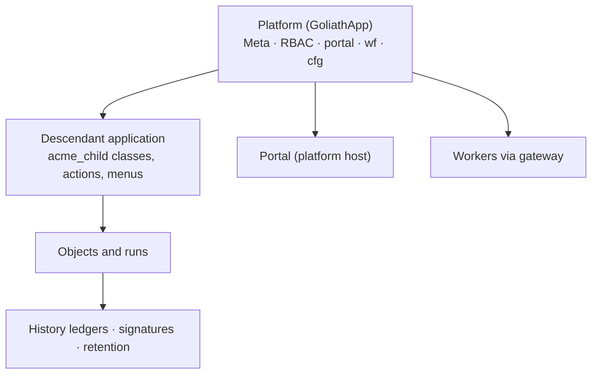
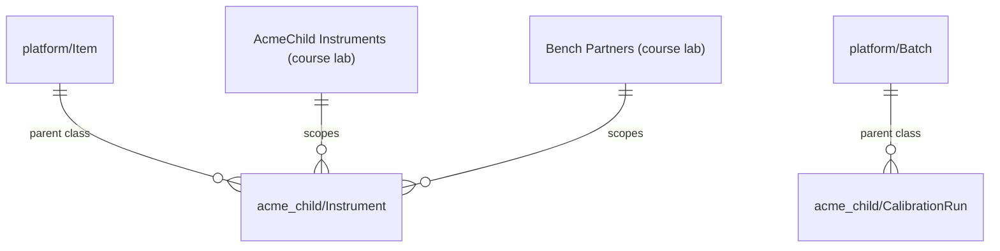

# *Enterprise Platforms with GoliathApp*
# GoliathApp: Enterprise Application Concepts

*Enterprise Platforms with GoliathApp · Course 1 · Goliath Research Academy*

**Institution:** Goliath Research Academy
**Delivery Format:** Module Reference Guides (`*_content.md`), Interactive Marimo Reactive Notebooks (`.py`), a Reproducible PostgreSQL 19 Laboratory (`compose.yaml`) built with GoliathApp's own install scripts, the GoliathApp portal running locally, and Automated Verification Suites (`pytest`)
**Prerequisites:** [PostgreSQL with Python](https://github.com/Goliath-Research/PostgreSQL-with-Python) or equivalent (SQL, transactions, roles and grants, `psql`, Docker Compose, Python 3.11+ with `pytest`). Basic HTTP/JSON. No cloud account, identity provider or domain knowledge needed.

> **Status (November 2026).** All 14 module guides, four Marimo notebooks and the module test suites are
> written and pass against the lab. Module 13 teaches GoliathApp's audit and history features, merged in
> **GoliathApp #109–#112** (ledgers, object history, run history and retention, electronic signatures),
> and #113, which stores every timestamp as UTC whatever the session time zone. The lab is pinned to that
> commit on GoliathApp `main` in [`lab/GOLIATHAPP_PIN`](lab/GOLIATHAPP_PIN). The portal has no signing
> screen yet; signatures are exercised through the platform API.

---

## 1. Course Overview

GoliathApp is a **database-governed platform**: identity, the data model, behavior, workflows,
configuration and audit are governed rows in PostgreSQL, and products (descendant applications) extend
it with data instead of forking it. This course teaches the enterprise concepts behind that design by
installing the real platform, modeling a small domain on it, and following every change into the audit
trail. Every lab runs on your machine against GoliathApp's official schema and seed scripts.



## 2. Anchor Domain

One fictional company runs through every module: **AcmeChild Instruments (course lab)**, which keeps bench
instruments and their calibration runs, plus a second tenant, **Bench Partners (course lab)**, used to prove
isolation. All of it is synthetic course data created by [`lab/course_data.py`](lab/course_data.py) through
the platform's own functions; every name says "(course lab)" and every email uses the reserved `.invalid`
domain.



| Course user | Organization | Role |
|---|---|---|
| Ada Admin (course lab) | AcmeChild | `organization_admin`; also `god_architect` in this lab only |
| Oscar Operator (course lab) | AcmeChild | `acme_child_operator` |
| Olivia Outsider (course lab) | Bench Partners | `acme_child_operator` |

## 3. Fourteen-Module Syllabus (Five Stages)

### Stage A — Foundations

#### Module 1: Platform Thinking
* **Directory:** [`1 - Platform Thinking/`](1%20-%20Platform%20Thinking/)
* **Files:** [`01_content.md`](1%20-%20Platform%20Thinking/01_content.md), [`tests/test_module_01.py`](1%20-%20Platform%20Thinking/tests/test_module_01.py)
* **Focus:** Platform vs descendant vs standalone; the dependency rule and the tests that enforce it.

#### Module 2: Reproducible Installation
* **Directory:** [`2 - Reproducible Installation/`](2%20-%20Reproducible%20Installation/)
* **Files:** [`02_content.md`](2%20-%20Reproducible%20Installation/02_content.md), [`tests/test_module_02.py`](2%20-%20Reproducible%20Installation/tests/test_module_02.py)
* **Focus:** Ordered, idempotent schema apply; population layers; one least-privileged role per process.


### Stage B — Modeling the Domain as Data

#### Module 3: Meta Object Model I
* **Directory:** [`3 - Meta Object Model I/`](3%20-%20Meta%20Object%20Model%20I/)
* **Files:** [`03_content.md`](3%20-%20Meta%20Object%20Model%20I/03_content.md), [`03_meta_hierarchy_explorer.py`](3%20-%20Meta%20Object%20Model%20I/03_meta_hierarchy_explorer.py), [`tests/test_module_03.py`](3%20-%20Meta%20Object%20Model%20I/tests/test_module_03.py)
* **Focus:** Classes, single inheritance, per-level documents, links, polymorphic queries.

#### Module 4: Meta Object Model II
* **Directory:** [`4 - Meta Object Model II/`](4%20-%20Meta%20Object%20Model%20II/)
* **Files:** [`04_content.md`](4%20-%20Meta%20Object%20Model%20II/04_content.md), [`tests/test_module_04.py`](4%20-%20Meta%20Object%20Model%20II/tests/test_module_04.py)
* **Focus:** Generated JSON Schemas, validation layers, versioned class contracts.

#### Module 5: Actions as Class Methods
* **Directory:** [`5 - Actions as Class Methods/`](5%20-%20Actions%20as%20Class%20Methods/)
* **Files:** [`05_content.md`](5%20-%20Actions%20as%20Class%20Methods/05_content.md), [`tests/test_module_05.py`](5%20-%20Actions%20as%20Class%20Methods/tests/test_module_05.py)
* **Focus:** The action catalog, typed parameters, one owner class per action.

#### Module 6: The Semantic Layer
* **Directory:** [`6 - The Semantic Layer/`](6%20-%20The%20Semantic%20Layer/)
* **Files:** [`06_content.md`](6%20-%20The%20Semantic%20Layer/06_content.md), [`tests/test_module_06.py`](6%20-%20The%20Semantic%20Layer/tests/test_module_06.py)
* **Focus:** Semantic entities, attributes and vetted requests for portals and agents.


### Stage C — Identity, Access and Tenancy

#### Module 7: Authentication & Sessions
* **Directory:** [`7 - Authentication & Sessions/`](7%20-%20Authentication%20%26%20Sessions/)
* **Files:** [`07_content.md`](7%20-%20Authentication%20%26%20Sessions/07_content.md), [`tests/test_module_07.py`](7%20-%20Authentication%20%26%20Sessions/tests/test_module_07.py)
* **Focus:** OIDC sign-in, linked identities, hashed session tokens, active role.

#### Module 8: Authorization, Tenancy & Navigation
* **Directory:** [`8 - Authorization, Tenancy & Navigation/`](8%20-%20Authorization,%20Tenancy%20%26%20Navigation/)
* **Files:** [`08_content.md`](8%20-%20Authorization,%20Tenancy%20%26%20Navigation/08_content.md), [`08_permission_explainer.py`](8%20-%20Authorization,%20Tenancy%20%26%20Navigation/08_permission_explainer.py), [`tests/test_module_08.py`](8%20-%20Authorization,%20Tenancy%20%26%20Navigation/tests/test_module_08.py)
* **Focus:** Roles, scopes, tenants, layered rules, navigation, God Architect ownership of `platform/*`.


### Stage D — Executing Work

#### Module 9: Workflows as Data
* **Directory:** [`9 - Workflows as Data/`](9%20-%20Workflows%20as%20Data/)
* **Files:** [`09_content.md`](9%20-%20Workflows%20as%20Data/09_content.md), [`tests/test_module_09.py`](9%20-%20Workflows%20as%20Data/tests/test_module_09.py)
* **Focus:** Versioned workflow graphs, instances and node executions.

#### Module 10: Distributed Workers & Leases
* **Directory:** [`10 - Distributed Workers & Leases/`](10%20-%20Distributed%20Workers%20%26%20Leases/)
* **Files:** [`10_content.md`](10%20-%20Distributed%20Workers%20%26%20Leases/10_content.md), [`10_lease_simulator.py`](10%20-%20Distributed%20Workers%20%26%20Leases/10_lease_simulator.py), [`tests/test_module_10.py`](10%20-%20Distributed%20Workers%20%26%20Leases/tests/test_module_10.py)
* **Focus:** Claims, leases, heartbeats, reclaim; workers only talk to the gateway.

#### Module 11: Events & Device Adapters
* **Directory:** [`11 - Events & Device Adapters/`](11%20-%20Events%20%26%20Device%20Adapters/)
* **Files:** [`11_content.md`](11%20-%20Events%20%26%20Device%20Adapters/11_content.md), [`tests/test_module_11.py`](11%20-%20Events%20%26%20Device%20Adapters/tests/test_module_11.py)
* **Focus:** Idempotent event ingest, subscriptions, hash-chained event ledgers.

#### Module 12: Configuration & Entitlements
* **Directory:** [`12 - Configuration & Entitlements/`](12%20-%20Configuration%20%26%20Entitlements/)
* **Files:** [`12_content.md`](12%20-%20Configuration%20%26%20Entitlements/12_content.md), [`tests/test_module_12.py`](12%20-%20Configuration%20%26%20Entitlements/tests/test_module_12.py)
* **Focus:** Typed configuration documents: draft, publish, content hashes, secret references.


### Stage E — Trust, Extension and Operations

#### Module 13: Traceability & Audit
* **Directory:** [`13 - Traceability & Audit/`](13%20-%20Traceability%20%26%20Audit/)
* **Files:** [`13_content.md`](13%20-%20Traceability%20%26%20Audit/13_content.md), [`13_evidence_trail.py`](13%20-%20Traceability%20%26%20Audit/13_evidence_trail.py), [`tests/test_module_13.py`](13%20-%20Traceability%20%26%20Audit/tests/test_module_13.py)
* **Focus:** Object history, as-of reads, run history and retention, electronic signatures, ledger verification.

#### Module 14: Descendant Applications & Capstone
* **Directory:** [`14 - Descendant Applications & Capstone/`](14%20-%20Descendant%20Applications%20%26%20Capstone/)
* **Files:** [`14_content.md`](14%20-%20Descendant%20Applications%20%26%20Capstone/14_content.md), [`tests/test_module_14.py`](14%20-%20Descendant%20Applications%20%26%20Capstone/tests/test_module_14.py)
* **Focus:** Rebuild from scratch, prove it end to end through the portal, write the runbook.

## 4. Assessment & Grading Rubric

| Component | Weight | Deliverable |
| :--- | :---: | :--- |
| Module labs 2–12 (tests + evidence) | 45% | Module test suites pass on your lab; written evidence with no secrets or connection strings |
| Concept checkpoints (Modules 1, 4, 8, 13) | 15% | Boundary classification, version predictions, access matrix, ALCOA+ table |
| Capstone (Module 14) | 40% | Fresh-lab rebuild, full `pytest` including portal tests, `RUNBOOK.md`, boundary statement, ledger checkpoint |

## 5. Reproducible Laboratory Setup

```text
GoliathApp-Enterprise-Concepts/
├── README.md  LICENSE  pyproject.toml  .env.example
├── compose.yaml            # postgres:19-bookworm on 127.0.0.1
├── compose.learner.yaml    # one private lab per learner on a shared machine
├── course_lab.py           # up | setup | status | psql | down | reset | learner up|down
├── course_support/         # shared helpers for notebooks and tests
├── lab/                    # GOLIATHAPP_PIN, setup_lab.py, course_data.py
├── tests/                  # portal tests (opt-in)
└── 1 - Platform Thinking/ … 14 - Descendant Applications & Capstone/
```

### 5.1 Start the database

```bash
python -m venv .venv && source .venv/bin/activate
pip install -e .
cp .env.example .env
python course_lab.py up
```

### 5.2 Build the lab from GoliathApp's official scripts

```bash
python course_lab.py setup
python course_lab.py status      # "Course lab ready."
pytest                           # every module suite
```

`setup` clones GoliathApp at the pinned commit into `.lab/GoliathApp`, installs its Python package into
your venv, runs `apply_schema.sh`, the semantic and action catalog seeds and the platform menu seed,
then adds the course data. It is safe to re-run, and it refuses any database host that is not local.

### 5.3 Run the GoliathApp portal against the lab

Requires Node.js 22+. From `.lab/GoliathApp` (the portal signs in as the course operator, whose id
`setup` wrote to `.lab/lab.env`):

```bash
npm ci && npm run build
cd apps/platform-host
set -a; . ../../../lab.env; set +a
GOLIATH_P1_DEV_LOGIN_USER_ID="$COURSE_OPERATOR_USER_ID" \
PGHOST=127.0.0.1 PGPORT=54339 PGDATABASE=goliathapp_lab PGSSLMODE=disable \
GOLIATH_PORTAL_PASSWORD=lab_portal_pw_change_me \
GOLIATH_PLATFORM_HOST_DEV_LOGIN=1 GOLIATH_PLATFORM_HOST_DEV_LOGIN_SECRET=local-course-lab-only \
npx next dev --port 3410
```

Then, in another terminal at the course root:

```bash
COURSE_PORTAL_URL=http://127.0.0.1:3410 COURSE_PORTAL_DEV_LOGIN_SECRET=local-course-lab-only \
pytest tests/test_portal_lab.py
```

The dev login is GoliathApp's integration-only sign-in. Use it only on this local lab; it must never be
enabled on a shared or production portal.

### 5.4 Notebooks

```bash
marimo edit "3 - Meta Object Model I/03_meta_hierarchy_explorer.py"
python -m marimo check "13 - Traceability & Audit/13_evidence_trail.py"
```

### 5.5 Continuous integration

`.github/workflows/course-lab.yml` builds the lab on `postgres:19-bookworm` with the official scripts,
runs every module suite, builds and starts the portal against the lab, and runs the portal tests.

### Lab boundaries

* Disposable, local database only; loopback ports; no shared or production database, ever.
* Never paste passwords, tokens or connection strings into evidence.
* Course data is synthetic and labelled; do not load customer or tenant data into the lab.

## 6. Follow-On Course

*Genomics with GoliathOmics* (in preparation) applies these platform concepts to a full descendant application.

## 7. Institutional & Disclosure Notice
* **Non-Credit / Portfolio Alignment:** Courses offered directly through **Goliath Research Academy** (`academy.goliathresearch.com`) are non-credit professional and technical training modules. While aligned with Florida Statewide Course Numbering System (SCNS) competencies for portfolio and prior-learning assessment (PLA) documentation, direct college credit is awarded solely at the discretion of accredited receiving institutions.
